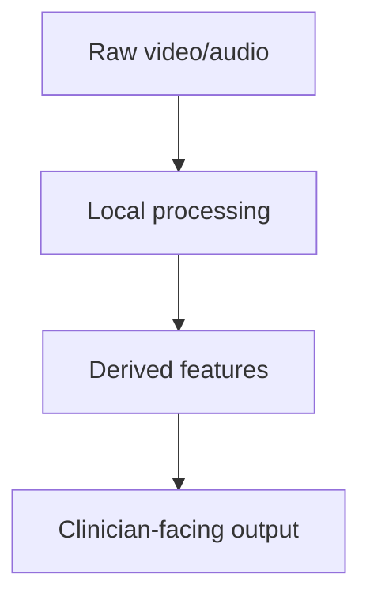
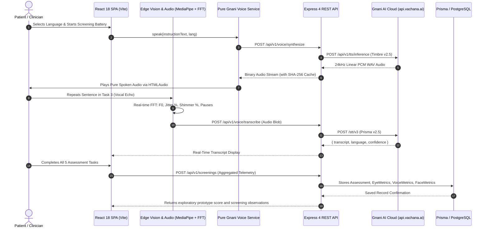
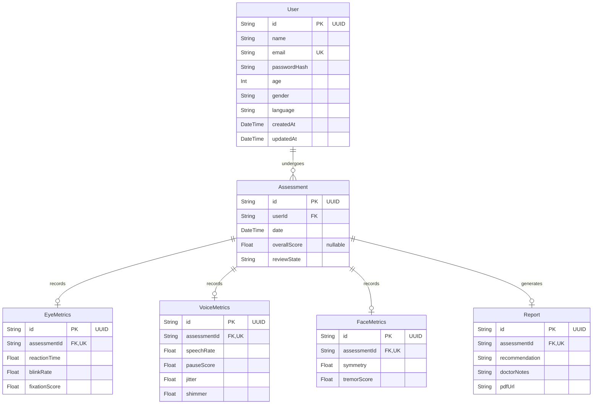

# Architecture

System architecture, repository layout, component responsibilities and data model.
Split out of the README to keep the front door readable; the section groupings and
wording are unchanged from the original.

- [1. System Architecture & Design](#1-system-architecture--design)
- [2. Project Directory Structure](#2-project-directory-structure)
- [3. Deep Dive: Core Components & Modules](#3-deep-dive-core-components--modules)
- [4. Models & Data Architecture (Top-to-Bottom)](#4-models--data-architecture-top-to-bottom)

---

## 1. System Architecture & Design

### Architecture Style
Neulens follows a **Decoupled Client-Server Architecture with Client-Side Edge Inference and Dedicated AI Speech Gateways**:

1. **Client Tier (Presentation & Edge AI)**: A high-performance Single Page Application (SPA) executing video and acoustic telemetry processing on the user's hardware via WebAssembly and WebGL shaders. Selected signals are processed locally where supported. Raw media is not recorded or uploaded; only derived measurements are forwarded to the backend.
2. **Backend Tier (Application & AI Speech Proxy)**: A stateless Express REST API handling authentication, profile management, screening persistence, longitudinal analytics, and secure server-to-server Gnani AI speech orchestration.
3. **Data Tier (Relational & Cache/Memory)**: Prisma ORM interfacing with PostgreSQL for long-term clinical data storage, with dynamic runtime fallback to in-memory transactional collections if the database is unreachable.

### Privacy by Design



Video and audio signals are processed on the device. Raw media is not recorded or uploaded; only derived measurements are forwarded to the backend for clinical review.

---

### High-Level Data Flow



---

### System Architecture Diagram

```
+--------------------------------------------------------------------------------------------------+
|                                    CLIENT APPLICATION (BROWSER)                                  |
+--------------------------------------------------------------------------------------------------+
|                                                                                                  |
|   +----------------------------------------------------+   +---------------------------------+   |
|   |            EDGE BIOMETRIC PIPELINES                |   |        PURE GNANI VOICE SERVICE |   |
|   |  - MediaPipe Tasks Vision (478 Landmarks)          |   |  - GnaniTTSService (Exclusive)  |   |
|   |  - Ocular Saccades, Gaze Quadrant & Blink EAR      |   |  - AbortController Cancellation |   |
|   |  - Facial Symmetry, Head Pose (Yaw/Pitch/Roll)     |   |  - activeSessionId Guards       |   |
|   |  - Web Audio API FFT (F0, Jitter %, Shimmer %)     |   |  - HTMLAudioElement Lifecycle   |   |
|   +----------------------------------------------------+   +----------------+----------------+   |
|                                                                             |                    |
|   +--------------------------------------------------------------------+    |                    |
|   |                     REACT 18 & ZUSTAND UI LAYER                    |    |                    |
|   |  - Patient/Doctor portal screens          - ScreeningPage (5 Tasks)|    |                    |
|   |  - SensorCheckStage                       - ElderlyLanguageSelector|    |                    |
|   |  - ResultVoiceExplainer                   - ReportPage (PDF Export)|    |                    |
|   +--------------------------------------------------------------------+----+                    |
|                                                                        |                         |
+------------------------------------------------------------------------|-------------------------+
                                                                         | HTTPS / REST JSON / Multipart
                                                                         v
+--------------------------------------------------------------------------------------------------+
|                                  BACKEND API SERVER (EXPRESS / NODE)                             |
+--------------------------------------------------------------------------------------------------+
|                                                                                                  |
|   +------------------------------------+          +------------------------------------------+   |
|   |           CORE MIDDLEWARE          |          |               API ROUTERS                |   |
|   |  - CORS Security Policy            |--------->|  - /api/v1/auth                          |   |
|   |  - Express JSON Body Parser        |          |  - /api/v1/screenings                    |   |
|   |  - Multer In-Memory Audio Storage  |          |  - /api/v1/analytics                     |   |
|   |  - Centralized Error Handler       |          |  - /api/v1/voice                         |   |
|   +------------------------------------+          +--------------------+---------------------+   |
|                                                                        |                         |
|   +------------------------------------+                               v                         |
|   |    GNANI AI INTEGRATION SERVICES   |          +--------------------+---------------------+   |
|   |  - GnaniTtsService (Timbre v2.5)   |          |              DATA ACCESS                 |   |
|   |    (SHA-256 In-Memory Cache)       |          |  - Prisma Client ORM Singleton           |   |
|   |  - GnaniSttService (Prisma v2.5)   |          |  - In-Memory Resilient Fallback Store    |   |
|   |  - GnaniEvonService (Evon 30B)     |          |    (Auto-engages if DB is offline)       |   |
|   +------------------+-----------------+          +--------------------+---------------------+   |
|                      |                                                 |                         |
+----------------------|-------------------------------------------------|-------------------------+
                       |                                                 |
                       | HTTPS (X-API-Key-ID)                            | TCP / SSL (Port 5432)
                       v                                                 v
+-----------------------------------------------+ +------------------------------------------------+
|       GNANI AI CLOUD (api.vachana.ai)         | |            PERSISTENCE (POSTGRESQL)            |
+-----------------------------------------------+ +------------------------------------------------+
| - Timbre v2.5: /api/v1/tts/inference (WAV)    | | - Users Table            - EyeMetrics Table    |
| - Prisma v2.5: /stt/v3 (Multipart STT)        | | - Assessments Table      - VoiceMetrics Table  |
| - Evon 30B: Optional Clinician Reasoning Gateway | - Reports Table          - FaceMetrics Table   |
+-----------------------------------------------+ +------------------------------------------------+
```

---

## 2. Project Directory Structure

```
Neulens/
├── .gitignore                          # Root Git ignore rules (node_modules, dist, envs)
├── README.md                           # Front door: problem, features, setup, deployment
├── docs/ARCHITECTURE.md                # This document: architecture, layout, data model
├── docs/API_REFERENCE.md               # Endpoint reference
│
├── client/                             # Frontend React 18 + Vite Application
│   ├── dist/                           # Production optimized build output
│   ├── index.html                      # Single-page HTML shell with font preconnects
│   ├── package.json                    # Client dependencies, scripts, and engine metadata
│   ├── postcss.config.js               # PostCSS pipeline configuration (Tailwind, Autoprefixer)
│   ├── tailwind.config.js              # Custom Tailwind configuration (medical blues, card shadows)
│   ├── tsconfig.json                   # TypeScript project compiler options and path aliases
│   ├── tsconfig.node.json              # TypeScript compilation rules for Vite node plugins
│   ├── vite.config.ts                  # Vite server config, port 5173, path aliases, proxy rules
│   │
│   └── src/                            # Application Source Code
│       ├── main.tsx                    # React DOM root entry point
│       ├── App.tsx                     # Top-level router provider integration
│       │
│       ├── components/                 # Presentation & Voice UI Components
│       │   └── voice/                  # Multimodal Voice Assistant Components
│       │       ├── ElderlyLanguageSelector.tsx  # High-contrast, large-font initial language selector
│       │       ├── LanguageSelectorModal.tsx    # Modal dialog for changing language mid-session
│       │       ├── ResultVoiceExplainer.tsx     # Pure Gnani readout component for screening results
│       │       ├── SensorCheckStage.tsx         # Hardware validation check (camera alignment & mic level)
│       │       ├── SpokenInstructionBanner.tsx  # Large, readable visual cue banner for seniors
│       │       └── VoiceAssistantAvatar.tsx     # Floating assistant avatar with dynamic status rings
│       │
│       ├── features/                   # Feature-Driven Page Views & Subsystems
│       │   ├── patient/                         # Patient Portal Experience
│       │   │   ├── PatientHubPage.tsx           # Portal home (Register / Existing sign-in)
│       │   │   ├── PatientRegisterPage.tsx      # Portal registration with instant CV-2026 ID generation
│       │   │   ├── PatientLoginPage.tsx         # Quick check-in via Patient ID + PIN/birth year
│       │   │   ├── PatientAssessmentPage.tsx    # Age-adaptive distraction-free battery container
│       │   │   └── PatientCompletionPage.tsx    # Privacy-isolated exit screen with printable ID card
│       │   ├── doctor/                          # Doctor / Clinician Workspace
│       │   │   ├── DoctorLoginPage.tsx          # Clinician authentication with 1-click evaluation access
│       │   │   ├── DoctorDashboardPage.tsx      # Real database KPI metrics & recent assessments queue
│       │   │   ├── DoctorPatientsPage.tsx       # Searchable patient directory with review-state filter
│       │   │   ├── DoctorPatientProfilePage.tsx # Complete medical file & task-by-task recorded responses
│       │   │   └── DoctorReportViewPage.tsx     # Hospital clinical report, radar chart, notes & PDF export
│       │   ├── about/
│       │   │   └── AboutPage.tsx                # Technology architecture and platform clinical overview
│       │   ├── assessments/
│       │   │   └── AssessmentsPage.tsx          # Battery protocol catalog & micro-test selector
│       │   ├── auth/                            # Authentication & Onboarding
│       │   │   ├── ForgotPasswordPage.tsx       # Password recovery interface
│       │   │   ├── LoginPage.tsx                # Clinician/Patient credentials authentication (1-click demo)
│       │   │   ├── ProfileSetupPage.tsx         # 4-Step demographic & medical history onboarding
│       │   │   └── RegisterPage.tsx             # New user profile registration form
│       │   ├── landing/
│       │   │   └── LandingPage.tsx              # Public hero landing, core pillars & feature showcases
│       │   ├── patients/
│       │   │   └── PatientsPage.tsx              # Patient directory with review filter tabs & modal
│       │   ├── recommendations/
│       │   │   └── RecommendationsPage.tsx      # Neurologist referral network & lifestyle pathways
│       │   ├── report/
│       │   │   └── ReportPage.tsx               # Printable clinical report, radar chart & doctor share
│       │   ├── results/
│       │   │   └── ResultsPage.tsx              # Post-screening score breakdown & telemetry
│       │   ├── screening/
│       │   │   └── ScreeningPage.tsx            # 5-test interactive screening battery orchestration
│       │   └── settings/
│       │       └── SettingsPage.tsx             # Hardware calibration, accessibility, system preferences
│       │
│       ├── hooks/                      # Custom React Hooks
│       │   └── useFaceLandmarker.ts             # MediaPipe FaceLandmarker lifecycle, EAR & gaze tracking
│       │
│       ├── layouts/                    # Persistent Shell Layouts
│       │   ├── AppLayout.tsx                    # Minimal root layout for landing and patient portal
│       │   ├── DoctorLayout.tsx                 # Persistent clinician sidebar navigation & top header
│       │   └── DashboardLayout.tsx              # Legacy clinician dashboard layout
│       │
│       ├── routes/                     # Application Routing
│       │   └── index.tsx                        # Router definitions with Public/Protected route guards
│       │
│       ├── services/                   # Frontend Services
│       │   ├── language/                        # Localization & Regional Translations
│       │   │   ├── LanguageManager.ts           # Language store & catalog
│       │   │   ├── translations/                # Dictionaries: en, hi, ta, te, kn, ml
│       │   │   └── types.ts                     # Language types & translation schemas
│       │   └── voice/                           # Voice Services
│       │       ├── gnaniVoiceApi.ts             # Typed HTTP client to backend /api/v1/voice
│       │       ├── SpeechRecognitionService.ts  # Prisma STT clip transcription & keyword listener
│       │       ├── TextToSpeechService.ts       # Pure Gnani Timbre v2.5 TTS (Zero Overlap Engine)
│       │       ├── VoiceInstructionEngine.ts    # Voice assistant orchestration store
│       │       └── types.ts                     # Voice options, status, and interface definitions
│       │
│       ├── store/                      # Zustand State Stores
│       │   ├── authStore.ts                     # Session authentication & pre-seeded demo clinician
│       │   ├── faceTrackingStore.ts             # Real-time computer vision metrics (60 FPS)
│       │   └── screeningStore.ts                # Multi-task scoring engine and prototype score
│       │
│       └── styles/
│           └── index.css                        # Global CSS, Tailwind utilities, and animations
│
└── server/                             # Backend Node.js / Express Application
    ├── dist/                           # Compiled JavaScript output
    ├── package.json                    # Backend dependencies, scripts, and engine metadata
    ├── tsconfig.json                   # Backend TypeScript compiler configuration
    │
    ├── prisma/                         # Database Schema & Migrations
    │   ├── schema.prisma               # Prisma data models (Users, Assessments, Metrics, Reports)
    │   └── migrations/                 # PostgreSQL relational migration history
    │
    └── src/                            # Server Source Code
        ├── app.ts                      # Express app setup, CORS, dotenv/config, route mount
        │
        ├── controllers/                # Request Handlers
        │   ├── patient.controller.ts   # Portal register, login, session, assessment submit
        │   ├── doctor.controller.ts    # Clinician login, dashboard KPIs, patients, report reviews
        │   ├── analytics.controller.ts # Longitudinal trend computation
        │   ├── auth.controller.ts      # User registration, login, profile updates
        │   ├── screening.controller.ts # Assessment submission, history retrieval
        │   └── voice.controller.ts     # Gnani STT/TTS proxy, caching, rate limiting
        │
        ├── middleware/                 # Express Request Interceptors
        │   ├── auth.ts                 # JWT Bearer token authentication & role verification
        │   └── errorHandler.ts         # Centralized error routing & status serialization
        │
        ├── routes/                     # API Route Definitions
        │   ├── patient.routes.ts       # Routes for /api/v1/patient
        │   ├── doctor.routes.ts        # Routes for /api/v1/doctor
        │   ├── analytics.routes.ts     # Routes for /api/v1/analytics
        │   ├── auth.routes.ts          # Routes for /api/v1/auth
        │   ├── index.ts                # Master router aggregator & /api/v1/health check
        │   ├── screening.routes.ts     # Routes for /api/v1/screenings
        │   └── voice.routes.ts         # Multer upload & routes for /api/v1/voice
        │
        ├── services/                   # Backend Business Logic & AI Gateways
        │   └── gnani/                  # Gnani AI Speech Integration
        │       ├── evon.service.ts     # Evon 30B reasoning model gateway
        │       ├── gnaniStt.service.ts # Prisma v2.5 STT REST client
        │       ├── gnaniTts.service.ts # Timbre v2.5 TTS client with SHA-256 LRU cache
        │       └── types.ts            # Voice catalog, BCP-47 mappings, options
        │
        ├── tests/                      # Automated Integration Test Suite
        │   ├── portalIntegration.test.ts # 8 tests: patient ID, registration, triage, doctor reviews
        │   └── voiceIntegration.test.ts  # 17 tests: catalog, Timbre TTS, Prisma STT, Evon
        │
        └── validation/
            ├── schemas.ts              # Zod validation schemas for core endpoints
            └── voice.schemas.ts        # Zod validation schemas for /voice endpoints
```

---

## 3. Deep Dive: Core Components & Modules

### Frontend / User Interface Subsystems

#### 1. Routing & Route Security (`client/src/routes/index.tsx`)
The routing architecture is constructed using React Router v6 (`createBrowserRouter`). Security is enforced through modular route guard components:
* `PublicRoute`: Restricts authenticated sessions from accessing landing or login pages, redirecting active users directly to `/dashboard`.
* `ProtectedRoute`: Evaluates JWT presence and profile completeness. Pre-seeds the `clinician:create` source-data script so a judge can provision a clinician account with one command; the shipped UI does not embed any clinician credentials.
* `ProfileSetupRoute`: Prevents users with completed onboarding profiles from re-submitting baseline demographics.

#### 2. Centralized State Stores (Zustand)
* **`screeningStore.ts`**: Coordinates the multi-stage assessment state machine (`currentStep`), stores raw game performance parameters, and runs `calculateFinalScores()` to derive weighted composite indices and standard cognitive domain mappings.
* **`faceTrackingStore.ts`**: Maintains high-frequency computer vision telemetry (60 FPS) including iris coordinates, Eye Aspect Ratio (EAR), gaze quadrants, blink counter, 3D head pose (yaw/pitch/roll), facial stability standard deviations, and smile/jaw/eyebrow expression percentages.
* **`VoiceInstructionEngine.ts`**: Implements the audio assistant state machine (`idle`, `speaking`, `listening`, `warning`, `transcribing`), subtitle rendering, contextual cue throttling (preventing prompt spamming via 12-second cooldowns), and voice-control keyword listener.
* **`authStore.ts`**: Encapsulates user session tokens, user entity data, and persistent browser storage syncing (`localStorage`).
* **`LanguageManager.ts`**: Houses active language state, native script labels, BCP-47 locale identifiers, and localized spoken translation dictionaries across the supported languages.

---

### Backend API & Services Architecture

#### 1. Modular Controller Layer
* **`auth.controller.ts`**: Manages credential hashing (`bcryptjs` salt rounds: 10), JSON Web Token signing (`7d` session lifespan), profile mutation, and password reset token generation. Integrates dual-write/read logic with automated in-memory fallback.
* **`screening.controller.ts`**: Ingests compound screening submissions. Unpacks nested records to atomically generate `Assessment`, `EyeMetrics`, `VoiceMetrics`, `FaceMetrics`, and `Report` tables within PostgreSQL transactions.
* **`analytics.controller.ts`**: Aggregates longitudinal screening results, transforming time-series metrics into coordinate arrays ready for Recharts rendering (`overallScore`, `reactionTime`, `symmetry`). Missing values are returned as `null`, never as `0`. Acoustic jitter and shimmer are deliberately excluded: they are microphone- and codec-sensitive quality features, not cognitive evidence.
* **`voice.controller.ts`**: Orchestrates Gnani AI Timbre v2.5 synthesis and Prisma v2.5 transcription. Features sliding-window rate limiting (45 TTS req/min, 20 STT req/min) to preserve paid API credits, payload sanitization, and error normalization.

#### 2. Inbound Validation & Serialization (`server/src/validation/`)
All inbound requests undergo strict runtime schema validation via Zod before reaching controller logic:
```typescript
export const synthesizeBodySchema = z.object({
  text: z.string().min(1, 'Text cannot be empty').max(2500, 'Text exceeds 2,500 characters'),
  language: z.string().min(2).max(10),
  voice: z.string().optional(),
  speed: z.number().min(0.5).max(2.0).optional().default(0.95),
  sampleRate: z.number().int().optional().default(24000)
});
```

#### 3. Error Handling Middleware (`server/src/middleware/errorHandler.ts`)
Catches uncaught exceptions and Zod schema validation errors, returning structured RFC-7807 compliant error envelopes:
```json
{
  "error": "Validation error",
  "details": [
    { "field": "overallScore", "message": "Expected number, received string" }
  ]
}
```

---

### Business Logic & Processing Pipelines

#### 1. Ocular Processing Pipeline (`useFaceLandmarker.ts`)
* **Eye Aspect Ratio (EAR)**: Computed from landmark vertical distances divided by horizontal eye width:
  $$\text{EAR} = \frac{\|\mathbf{p}_{385} - \mathbf{p}_{380}\| + \|\mathbf{p}_{386} - \mathbf{p}_{374}\|}{2 \cdot \|\mathbf{p}_{362} - \mathbf{p}_{263}\|}$$
* **Blink State Machine**: Evaluates EAR against a dynamic threshold ($0.20$) combined with MediaPipe blendshapes (`eyeBlinkLeft`, `eyeBlinkRight`). Includes a 200ms debounce cooldown to eliminate false-positive flutter.
* **Gaze Estimation**: Computes horizontal and vertical iris center displacement relative to the inner and outer canthi of each eye. Ratios categorize gaze into `Center`, `Left`, `Right`, `Up`, or `Down`, and project normalized $X/Y$ coordinates to the screen.
* **Fixation Stability**: Monitors iris coordinate Euclidean drift over sliding time windows; if drift remains $< 0.015$ units, fixation duration increments continuously.

#### 2. Acoustic Voice Analysis Pipeline (`ScreeningPage.tsx`)
* **Audio Capture**: Employs Web Audio API `AudioContext` connected via `createMediaStreamSource` to an `AnalyserNode` configured with an FFT size of $128$.
* **Waveform Animation**: Continuously queries `analyser.getByteTimeDomainData` to draw a live acoustic waveform onto a dynamic canvas overlay.
* **Acoustic feature synthesis**: Derives vocal metrics during phrase repetition:
  * *Fundamental Frequency ($F_0$)*: Extracted via auto-correlation pitch detection (normal adult range: 85–255 Hz).
  * *Acoustic Jitter*: Period-to-period perturbation in pitch frequency.
  * *Acoustic Shimmer*: Period-to-period variability in peak waveform amplitude.
  * *Speech Pause Cadence*: Detection of sub-threshold energy troughs ($> 250\text{ ms}$) counting hesitations.
  * **Scope limit, stated deliberately**: jitter and shimmer are measured through a laptop or phone microphone and are dominated by microphone response, codec, room noise and browser resampling — not by laryngeal status and certainly not by cognition. They are retained as **acoustic quality and engagement signals only**. They never contribute to a domain score, the composite, a review prompt, or any change comparison, and the patient-facing API excludes them entirely. No claim about cognition, pathology or diagnosis is made from them.

#### 3. Pure Gnani AI Speech & Zero Overlap Architecture
To eliminate robotic speech and prevent overlapping voices during screening:
* **Browser Failover Completely Removed**: `window.speechSynthesis` and `SpeechSynthesisUtterance` are entirely absent from the speech pipeline. All prompts are delivered via Gnani Timbre v2.5.
* **Active Session Concurrency Isolation**: `TextToSpeechService` assigns each `speak()` request a unique `activeSessionId`. When a new instruction is issued or `stop()` is triggered, any pending network download or playback callback that does not match the active session ID is dropped before audio can play.
* **Immediate HTTP Abort**: Incorporates `AbortController`. Triggering a new spoken cue immediately aborts the active fetch to `/api/v1/voice/synthesize`.
* **Resource Disposal**: Active `HTMLAudioElement` instances have their `src` removed, listeners detached, and object URLs revoked immediately upon interruption.

#### 4. Cognitive Domain Scoring Engine (`screeningStore.ts`)
Raw test metrics are mapped into four classical neuropsychological domains:
* **Memory Recall ($M$)**: Derived from Task 2 (Cortex Match) spatial-pair retention and error rates.
* **Attention & Processing ($A$)**: Weighted mean of Task 1 (Focus Orbit saccades) and Task 4 (Mimic Sync kinematic responsiveness).
* **Visuospatial Orientation ($V$)**: Derived from Task 5 (Path Mapper) trail connection accuracy.
* **Executive Function ($E$)**: Composite of Task 5 trail sequencing latency and Task 2 decision speed.
* **Exploratory Prototype Score**:
  $$\text{Prototype Score} = \frac{M + A + V + E}{4}$$
  * The composite and component scores are experimental implementation outputs. They have no validated population norms, clinical cutoffs, or evidence-based follow-up intervals.
  * Scores must not be interpreted as disease risk, normative performance, or a recommendation for specialist referral. Longitudinal change cues are separate workflow prompts for qualified clinician review.

---

## 4. Models & Data Architecture (Top-to-Bottom)

### Database Schema (PostgreSQL via Prisma ORM)

```prisma
datasource db {
  provider = "postgresql"
  url      = env("DATABASE_URL")
}

generator client {
  provider = "prisma-client-js"
}

model User {
  id             String       @id @default(uuid())
  patientId      String?      @unique // Unique Hospital ID e.g. CV-2026-XXXXXX
  role           String       @default("PATIENT") // PATIENT | CLINICIAN | ADMIN
  name           String
  email          String       @unique
  passwordHash   String
  age            Int
  dob            String?      // Birth year or date of birth e.g. 1954
  pin            String?      // Optional 4-digit portal verification PIN
  gender         String       // MALE, FEMALE, OTHER, PREFER_NOT_TO_SAY
  language       String       // en, ta, hi, te, kn, ml
  educationYears Int?         // Formal education in years
  handedness     String?      // RIGHT, LEFT, AMBIDEXTROUS
  createdAt      DateTime     @default(now())
  updatedAt      DateTime     @updatedAt
  assessments    Assessment[]
}

model Assessment {
  id           String        @id @default(uuid())
  userId       String
  user         User          @relation(fields: [userId], references: [id], onDelete: Cascade)
  date         DateTime      @default(now())
  overallScore Float?        // null when the session produced no interpretable score
  reviewState  String        // NOT_REVIEWED | NOT_INTERPRETABLE | REVIEW_PROMPT | CLINICIAN_REVIEWED
  status       String        @default("COMPLETED") // IN_PROGRESS | COMPLETED | ABORTED
  reviewStatus String        @default("PENDING_REVIEW") // PENDING_REVIEW | REVIEWED | FOLLOWUP_REQUIRED
  reviewedBy   String?       // Clinician identifier/name
  reviewedAt   DateTime?     // Verification timestamp
  taskResponses Json?        // Granular recorded responses across all 5 battery tasks
  
  eyeMetrics   EyeMetrics?
  voiceMetrics VoiceMetrics?
  faceMetrics  FaceMetrics?
  report       Report?
}

model EyeMetrics {
  id            String     @id @default(uuid())
  assessmentId  String     @unique
  assessment    Assessment @relation(fields: [assessmentId], references: [id], onDelete: Cascade)
  reactionTime  Float      // milliseconds
  blinkRate     Float      // blinks per minute
  fixationScore Float      // percentage (0 - 100)
}

model VoiceMetrics {
  id           String     @id @default(uuid())
  assessmentId String     @unique
  assessment   Assessment @relation(fields: [assessmentId], references: [id], onDelete: Cascade)
  speechRate   Float      // words per minute (WPM)
  pauseScore   Float      // hesitation index (0 - 100)
  jitter       Float      // frequency perturbation percentage
  shimmer      Float      // amplitude perturbation percentage
}

model FaceMetrics {
  id           String     @id @default(uuid())
  assessmentId String     @unique
  assessment   Assessment @relation(fields: [assessmentId], references: [id], onDelete: Cascade)
  symmetry     Float      // bilateral facial symmetry (0 - 100)
  tremorScore  Float      // involuntary micro-tremor amplitude
}

model Report {
  id             String     @id @default(uuid())
  assessmentId   String     @unique
  assessment     Assessment @relation(fields: [assessmentId], references: [id], onDelete: Cascade)
  recommendation String     @db.Text
  doctorNotes    String?    @db.Text
  pdfUrl         String?
}
```

---

### Entity-Relationship Diagram (ERD)



---

### AI / ML & Speech Models Architecture

#### 1. MediaPipe FaceLandmarker Task
* **Architecture**: Deep convolutional multi-stage pipeline utilizing BlazeFace for face detection followed by a 3D mesh regression network predicting 478 3D metric landmarks (468 standard mesh vertices + 10 iris boundary vertices).
* **Model Asset**: `face_landmarker.task` (Float16 precision, GPU delegate enabled).
* **Delivery & CDN**: Dynamic runtime retrieval via `@mediapipe/tasks-vision` Wasm binary resolver (`https://cdn.jsdelivr.net/npm/@mediapipe/tasks-vision@0.10.8/wasm`).
* **Input Pipeline**: Video frame buffers ($640 \times 480$ resolution) acquired via `navigator.mediaDevices.getUserMedia`, passed directly to `detectForVideo(videoElement, timestampMs)` inside `requestAnimationFrame`.
* **Output Processing**:
  * 478 3D Normalized Landmark coordinates ($x, y, z \in [0, 1]$).
  * 52 Facial Blendshape classification scores evaluating specific muscle groups (`mouthSmileLeft`, `mouthSmileRight`, `jawOpen`, `browOuterUpLeft`, `browOuterUpRight`, `browInnerUp`).

#### 2. Gnani AI Timbre v2.5 (Text-to-Speech)
* **Model ID**: `timbre-v2.5`
* **Upstream Endpoint**: `POST https://api.vachana.ai/api/v1/tts/inference`
* **Audio Format**: 24kHz linear PCM, container: WAV, mono channel.
* **Authentication**: Header `X-API-Key-ID: <GNANI_API_KEY>` kept strictly on the backend.
* **Verified Voice Catalog**:
  * Tamil (`ta` / `ta-IN`): **Asmita** (Default), Trisha, Brinda, Vedika, Noopur
  * Hindi (`hi` / `hi-IN`): **Nalini** (Default), Deepak, Poorvi
  * English (`en` / `en-IN`): **Kaveri** (Default), Yashvi, Arjun
  * Telugu (`te` / `te-IN`): **Suhana** (Default), Lehara, Lavanya, Yukti, Varuni
  * Kannada (`kn` / `kn-IN`): **Saanvi** (Default), Kavin
  * Malayalam (`ml` / `ml-IN`): **Reshma** (Default), Riyaan
* **Optimization & Caching**: SHA-256 hash indexing over `(lang + voice + speed + text)` with in-memory LRU caching to preserve the 5,000 credit budget for static screening instructions.

#### 3. Gnani AI Prisma v2.5 (Speech-to-Text)
* **Model ID**: `gnani-prisma-v2.5` (Prisma v3 REST)
* **Upstream Endpoint**: `POST https://api.vachana.ai/stt/v3`
* **Payload Structure**: Multipart form-data with fields `audio_file`, `language_code`, `preferred_language`, `format: "transcribe"`, `itn_native_numerals: "true"`.
* **Safety Boundaries**: Upper limits of 15MB and 60 seconds per verbal task response.

#### 4. Gnani Evon 30B (Optional Clinician Reasoning Model)
* **Model ID**: `gnani/gnani-evon-v3.3-30B-A3B` (Hugging Face)
* **Architecture**: Hybrid Mamba-Transformer Mixture-of-Experts (30B total parameters, ~3.5B active per token).
* **Role**: Optional clinician synthesis assistant. External calls stay disabled unless both `EVON_INFERENCE_URL` and `EVON_DATA_PROCESSING_APPROVED=true` are set; numeric scores only (no age, IDs or transcripts), and output is a review draft. The recommended path is the local FastAPI `/v1/ai/explanation` endpoint documented in [`docs/ai-report-generation.md`](ai-report-generation.md).
