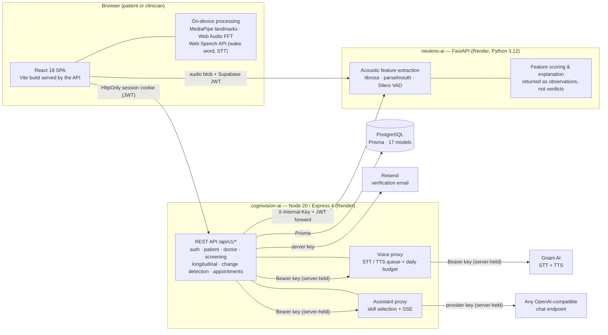
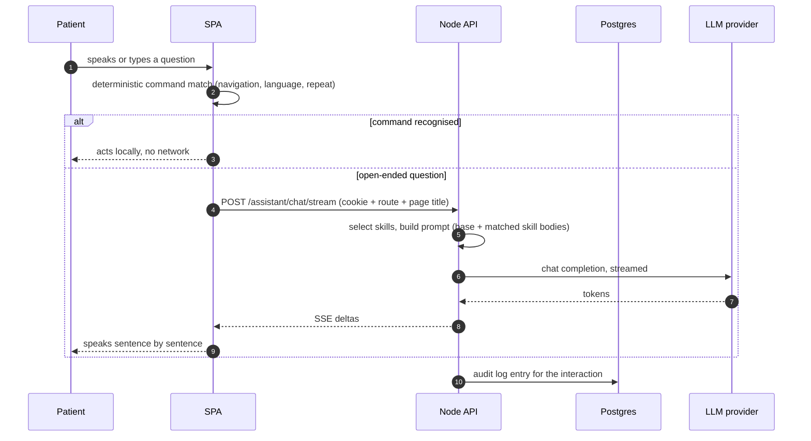

# NeuLens — deployed topology and trust boundaries

One page for reviewers: what runs where, and what credential guards each hop.
Companion to [`../ARCHITECTURE.md`](../ARCHITECTURE.md) (component detail) and
[`UAE_DEPLOYMENT_CHECKLIST.md`](UAE_DEPLOYMENT_CHECKLIST.md) (deploy settings).

## Services

## What crosses each boundary

| Hop | Credential | Never crosses |
| --- | --- | --- |
| Browser → Node API | HttpOnly, SameSite session cookie containing a short-lived JWT; role checked per route (`requireRole(['PATIENT'])`) | Provider keys, other patients' records |
| Browser → Python service | The patient's Supabase JWT, verified against Supabase JWKS, plus an allow-listed origin | Node's internal key, database credentials |
| Node → Python | `AI_SERVICE_INTERNAL_KEY` shared secret, matching `INTERNAL_API_KEY` | Public internet exposure of the Python service |
| Node → Gnani / LLM / Resend | Server-side environment variables only (`sync: false` in `render.yaml`) | Any key reaching the browser bundle |
| Node → Postgres | `DATABASE_URL` injected by Render | PHI in logs or the client |

## Request paths worth knowing

## Trust boundaries in one line each

- **The browser is untrusted.** All access control, rate limiting and prompt safety rules are enforced server-side; the client only hides controls.
- **Clinical interpretation stops at the clinician.** The assistant may explain what a score or page is, never whether it is good, bad or diagnostic.
- **Raw media stays on the device.** Only derived features and, for the speech tasks, the recorded audio needed for acoustic analysis are sent — no continuous recording or camera capture.
- **Degradation is visible, not silent.** No database → in-memory demo fallback and `/health` reports 503; no Gnani key → silent replies with written answers; no LLM → scripted replies.
